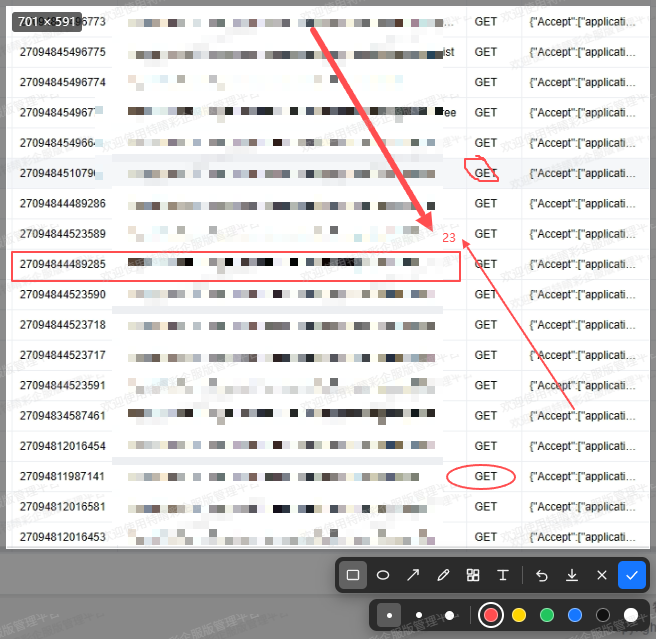

# vue-webscreenshot

**WeChat-style screenshot for the browser** — a pure client-side screenshot & annotation component built with Vue 3. One click to capture, select, annotate, and copy to clipboard or download — everything happens locally in the browser, **no upload, no storage, zero backend**.

<p align="center">
  <a href="https://www.npmjs.com/package/@yswenli/vue-webscreenshot"></a>
  <a href="https://github.com/yswenli/vue-webscreenshot/blob/main/LICENSE"></a>
  
  
  
  <a href="https://github.com/yswenli/vue-webscreenshot"></a>
</p>

<p align="center">
  <strong>English</strong> ·
  <strong><a href="./README.md">简体中文</a></strong>
</p>

<p align="center">
  
</p>

<p align="center"><sub>Select a region, annotate with rectangles / arrows, then copy or download in one click</sub></p>

---

## Why this component?

Adding a "screenshot feedback" feature usually drags in a screenshot library, backend storage, and even a whole OSS pipeline. `vue-webscreenshot` cuts all of that out:

- **Zero backend**: `getDisplayMedia` capture + Canvas composition, all inside the user's browser — no network requests at all.
- **Plug & play**: a single `<WebScreenshot />` tag, controlled with `v-model:show`; three lines of code to integrate.
- **Cross-browser**: Chrome / Edge / 360 Speed mode and macOS Safari 13+ share one implementation; Safari's clipboard gesture restriction is handled inside the component.
- **WeChat-screenshot experience**: six annotation tools — rectangle, ellipse, arrow, brush, mosaic and text — with thickness presets, a six-color palette and one-step undo.
- **Local & privacy-safe**: the captured image never leaves the browser, ideal for privacy-sensitive workflows (support tickets, bug reports, design walkthroughs).
- **Crisp & sharp**: rendered at device-pixel-ratio (DPR) resolution, so annotations stay clean at full quality.

> Great for: feedback / ticketing systems, bug reporting, test reports, live support, and collaborative docs — whenever you need to "draw a box around it and say what's wrong".

## Highlights

| Capability | Description |
| --- | --- |
| 🖱 Select & capture | Grab the full screen, drag to select, live pixel size readout |
| 🖐 Adjustable selection | Green frame + 8 resize handles once fixed; drag the region when no tool is active, annotations follow |
| ✏️ Six annotations | Rectangle / Ellipse / Arrow / Brush / Mosaic / Text |
| 🎨 Fine control | Three thickness levels (shapes/brush) · six-color palette · mosaic block size · text size and outline |
| ⏪ Undo | `Ctrl / Cmd + Z` or the toolbar button — one step back; annotations, text edits, selection moves and resizes are all recorded |
| 📋 One-click copy | Writes to clipboard first, falls back to download when unsupported; Safari's gesture requirement is handled |
| 💾 Timestamped download | Auto-named files like `screenshot-20261104-153000.png` |
| 🧩 Low coupling | `Teleport` to body, configurable `z-index`, no host-layout pollution |
| 🔤 Smart text | Input box auto-grows, final text lands **exactly where it previews**; click existing text to re-edit, multi-line with outline |
| 📐 Directional arrows | Preserves the drag direction — all eight directions point where you released |
| 📱 Responsive | Re-lays out on window resize; selection and annotations stay in place |
| 🌐 Browser support | Works out of the box on Chromium-based browsers and macOS Safari 13+; Safari 16.1+ can share a single window |

## Requirements

- Supports **Chromium-based browsers** (Chrome / Edge / 360 Speed mode) and **macOS Safari 13+** (officially supported since 1.1.0); Firefox is not adapted, and iOS / iPadOS Safari does not expose `getDisplayMedia`, so it reports "unsupported".
- Must run in a **secure context**: `https` or `localhost` / `127.0.0.1`. Screenshot capture is disabled by the browser on `http` pages served over LAN IPs.
- The first trigger opens the system screen-share panel: Chrome lets you pick the current tab / a window / the entire screen, while Safari uses the macOS panel to pick a screen or a window (single-window sharing requires Safari 16.1+ on macOS Ventura 13+). That is a browser mechanism, not a component defect.
- On macOS, allow the browser under "System Settings → Privacy & Security → Screen Recording"; the system prompts for it on first use.
- Copying relies on the Async Clipboard API. Safari requires the write to happen inside the user's click gesture, which the component has done since 1.1.0; if the browser still refuses (for example, the page is unfocused or not in a secure context), it falls back to download automatically.

## Install

```bash
npm install @yswenli/vue-webscreenshot --save
```

> The stylesheet is a separate artifact and **must be imported explicitly**, otherwise you get bare, unstyled controls:

```ts
import '@yswenli/vue-webscreenshot/css';
```

## Quick start

```vue
<template>
  <button @click="show = true">Take a screenshot</button>
  <WebScreenshot v-model:show="show" @success="onSuccess" />
</template>

<script setup lang="ts">
import { ref } from 'vue';
import WebScreenshot from '@yswenli/vue-webscreenshot';
import '@yswenli/vue-webscreenshot/css';

const show = ref(false);

function onSuccess(payload: { mode: 'clipboard' | 'download'; blob: Blob }) {
  // mode === 'clipboard': already written to clipboard, just Ctrl+V to paste
  // mode === 'download'  : the browser can't copy images, fell back to download
  console.log(payload.mode, payload.blob);
  show.value = false;
}
</script>
```

## API

### Props

| Name | Type | Default | Description |
| --- | --- | --- | --- |
| `show` | `boolean` | — | Set `true` to start capture and enter editing; the component emits `update:show` `false` when finished, so `v-model:show` works |
| `z-index` | `number` | `3000` | Overlay z-index; raise it if the host has higher-level overlays |
| `file-name` | `string` | `网页截图` | Download filename prefix, resulting in e.g. `网页截图-20261104-153000.png` |
| `capture-delay` | `number` | `1000` | Wait time (ms) after permission before grabbing the frame, to avoid a residual ghost of the closing share dialog |

### Events

| Name | Payload | Description |
| --- | --- | --- |
| `update:show` | `boolean` | Set to `false` when the component ends (done / cancelled / error) |
| `success` | `{ mode: 'clipboard' \| 'download'; blob: Blob }` | Clicked "Done". `mode` tells whether it actually wrote to clipboard or fell back to download |
| `download` | `{ blob: Blob }` | Clicked the toolbar "Download"; the tool stays open so you can keep editing |
| `cancel` | — | Clicked "Cancel", pressed `Esc`, or the user denied the screen-share permission |
| `error` | `{ stage: 'unsupported' \| 'capture' \| 'clipboard'; message: string }` | Environment unsupported, capture failed, or image composition failed |

### Shortcuts

| Action | Description |
| --- | --- |
| Drag | Select the screenshot region; after it's fixed, drag a handle or edge to resize, drag inside with no tool active to move it, or drag inside with a tool active to annotate |
| `Esc` | Close the text input if open; otherwise cancel and close |
| `Ctrl / Cmd + Z` | Undo the last action (new annotation, text edit, selection move, or selection resize) |
| `Enter` | Same as "Done" when not typing text; inserts a new line while typing |
| `Ctrl / Cmd + Enter` | Confirm the text while typing |
| `Shift + Enter` | New line while typing text — multi-line annotations supported |

### Usage notes

Toolbar: `Rectangle ｜ Ellipse ｜ Arrow ｜ Brush ｜ Mosaic ｜ Text ｜ Undo ｜ Download ｜ Cancel ｜ Done`. Selecting a drawing tool expands a secondary toolbar: shapes/brush get three thickness levels and a six-color palette, mosaic only gets block size, text gets font size, text color, and outline width + outline color. Default is red, 2px.

The text input box auto-grows with content. `Enter` inserts a new line; `Ctrl / Cmd + Enter` or clicking outside the box confirms. On commit, text lands according to the actual layout inside the box (including line breaks), exactly where you saw it — no shifting. Switching tools, undo / download / done also commit the in-progress text first. With the Text tool still active, clicking existing text reopens it in place with its original content and style, so you can change the text, size, color, or outline; clearing the content and confirming deletes it, and all of these edits are undoable.

Once the selection is fixed, a green frame with 8 handles (four corners + four edge midpoints) appears outside it: drag a handle or an edge to resize, and the size readout in the top-left updates live. When no annotation tool is active, dragging inside the selection moves it as a whole, and existing annotations follow the move or scale proportionally with it (stroke width and font size stay unchanged). With a tool active, dragging inside draws annotations again — click the active tool once more to deselect it and move the selection. Both moves and resizes go into the undo stack, so `Ctrl / Cmd + Z` steps back to the previous position and size.

On Safari, "Done" also copies first; it only switches to download when the clipboard write is refused by the system or browser policy.

## Known limitations

Kept transparent so you can judge whether it fits:

- No window/element auto-snapping, no magnifier, no color picker, no scrollable long screenshots.
- Only text annotations can be re-edited (click existing text with the Text tool active); other annotations can't be individually selected, dragged, or deleted — only whole-undo, though they do move and scale along with the selection.
- Annotations are clipped to the selection; text extending below the selection's bottom edge gets cut off.
- The captured content is whatever the user authorized to share; it isn't guaranteed to equal the current page.
- iOS / iPadOS Safari has no `getDisplayMedia`, so capture is unavailable there; use the system screenshot or another device.
- On Safari the share source is controlled by the macOS panel; unlike Chrome, you can't use constraints to pre-select a tab or window.

## Local development

```bash
npm install
npm run dev     # opens the demo page in index.html
npm run build   # vue-tsc type check + produce dist
```

## Contributing

Issues and pull requests are welcome via the [issue tracker](https://github.com/yswenli/vue-webscreenshot/issues) and [pull requests](https://github.com/yswenli/vue-webscreenshot/pulls). The codebase enforces strict TypeScript; please make sure `npm run build` passes before submitting.

## License

[MIT](./LICENSE) © yswenli
