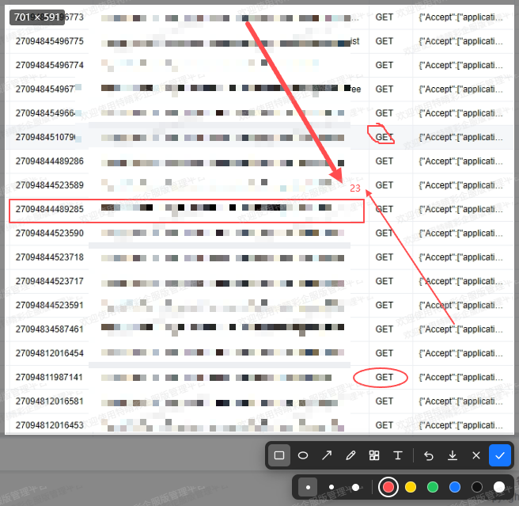

# vue-webscreenshot

**浏览器里的「微信截图」**：一个基于 Vue 3 的纯前端网页截图与标注组件。点击一下，框选、标注、一键复制到剪贴板或下载——全程在浏览器本地完成，**不上传、不落库、零后端依赖**。

<p align="center">
  <a href="https://www.npmjs.com/package/@yswenli/vue-webscreenshot"></a>
  <a href="https://github.com/yswenli/vue-webscreenshot/blob/main/LICENSE"></a>
  
  
  <a href="https://github.com/yswenli/vue-webscreenshot"></a>
</p>

<p align="center">
  <strong><a href="./README.en.md">English</a></strong> ·
  <strong>简体中文</strong>
</p>

<p align="center">
  
</p>

<p align="center"><sub>框选 + 方框 / 箭头标注，一键复制或下载</sub></p>

---

## 为什么用它？

给产品加「截图反馈」，往往意味着引入截图工具、后端存储、甚至整条 OSS 链路。`vue-webscreenshot` 把这些全砍掉：

- **零后端**：`getDisplayMedia` 抓屏 + Canvas 合成，全部发生在用户浏览器里，没有任何网络请求。
- **即插即用**：一个 `<WebScreenshot />` 标签，`v-model:show` 控制开关，三行代码接入。
- **对齐微信截图**：方框、椭圆、箭头、画笔、马赛克、文字六种标注，粗细 + 六色色板，撤销一步到位。
- **纯本地 & 隐私安全**：截图内容绝不出浏览器，天然适合隐私敏感的业务（客服工单、Bug 反馈、设计走查）。
- **清晰锐利**：按设备像素比（DPR）高清渲染，标注成品不糊。

> 适合用在：反馈/工单系统、Bug 上报、测试报告、在线客服、文档协作里的「框出来说清楚」。

## 核心特性

| 能力 | 说明 |
| --- | --- |
| 🖱 框选抓屏 | 全屏抓取后拖拽框选，实时显示选中尺寸（像素） |
| ✏️ 六种标注 | 方框 / 椭圆 / 箭头 / 画笔 / 马赛克 / 文字 |
| 🎨 精细控制 | 粗细三档（画笔/图形）· 六色色板 · 马赛克块大小 |
| ⏪ 撤销 | `Ctrl / Cmd + Z` 或工具栏按钮，一步撤销 |
| 📋 一键复制 | 优先写入剪贴板，浏览器不支持时自动降级为下载 |
| 💾 命名下载 | 文件名自动带时间戳，如 `网页截图-20261104-153000.png` |
| 🧩 低耦合 | `Teleport` 挂到 body，`z-index` 可配，不污染宿主布局 |
| 🔤 智能文字 | 输入框随内容自动增高，落字与预览**完全重合**、支持多行与换行 |
| 📐 箭头保向 | 保留拖拽方向，八个方向都指向松开鼠标的位置 |
| 📱 自适应 | 窗口尺寸变化时自动重排，选区与标注不失位 |

## 环境要求

- 支持 **Chromium 系**浏览器（Chrome / Edge / 360 极速模式）与 **macOS Safari 13+**；Firefox 未做适配，iOS / iPadOS Safari 不提供 `getDisplayMedia`，会走「不支持」提示。
- 必须在**安全上下文**中运行：`https` 或 `localhost` / `127.0.0.1`。局域网 IP 的 `http` 页面会被浏览器禁用抓屏。
- 首次点击会弹出系统共享授权框，由用户选择抓取范围（当前标签页 / 窗口 / 整个屏幕）。这是浏览器机制，非组件缺陷。

## 安装

```bash
npm install @yswenli/vue-webscreenshot --save
```

> 样式是独立产物，**必须显式引入**，否则看到的是无样式的裸控件：

```ts
import '@yswenli/vue-webscreenshot/css';
```

## 快速上手

```vue
<template>
  <button @click="show = true">截图</button>
  <WebScreenshot v-model:show="show" @success="onSuccess" />
</template>

<script setup lang="ts">
import { ref } from 'vue';
import WebScreenshot from '@yswenli/vue-webscreenshot';
import '@yswenli/vue-webscreenshot/css';

const show = ref(false);

function onSuccess(payload: { mode: 'clipboard' | 'download'; blob: Blob }) {
  // mode === 'clipboard'：已写入剪贴板，直接 Ctrl+V 即可粘贴
  // mode === 'download'  ：浏览器不支持复制图片，已自动改为下载
  console.log(payload.mode, payload.blob);
  show.value = false;
}
</script>
```

## API

### Props

| 名称 | 类型 | 默认值 | 说明 |
| --- | --- | --- | --- |
| `show` | `boolean` | — | 置 `true` 开始抓屏并进入编辑；组件结束后会 `emit('update:show', false)`，支持 `v-model:show` |
| `z-index` | `number` | `3000` | 遮罩层级，宿主有更高浮层时上调 |
| `file-name` | `string` | `网页截图` | 下载文件名前缀，最终形如 `网页截图-20261104-153000.png` |
| `capture-delay` | `number` | `1000` | 授权通过后到取帧的等待时间（毫秒），用于避开共享授权框关闭时的残影 |

### Events

| 名称 | 参数 | 说明 |
| --- | --- | --- |
| `update:show` | `boolean` | 组件结束（完成/取消/异常）后置 `false` |
| `success` | `{ mode: 'clipboard' \| 'download'; blob: Blob }` | 点「完成」。`mode` 表示实际写入剪贴板还是降级下载 |
| `download` | `{ blob: Blob }` | 点工具栏「下载」，此时工具不关闭，可继续操作 |
| `cancel` | — | 点「取消」、按 `Esc`，或用户拒绝屏幕共享授权 |
| `error` | `{ stage: 'unsupported' \| 'capture' \| 'clipboard'; message: string }` | 环境不支持抓屏、抓屏失败、出图失败 |

### 快捷键

| 操作 | 说明 |
| --- | --- |
| 拖拽 | 框选截图区域；定稿后在选区内拖拽进行标注 |
| `Esc` | 有文字输入框时先关输入框，否则取消并关闭 |
| `Ctrl / Cmd + Z` | 撤销最后一条标注 |
| `Enter` | 等同「完成」；文字输入状态下提交这段文字 |
| `Shift + Enter` | 文字输入状态下换行，支持多行标注 |

### 使用细节

工具栏：`方框｜椭圆｜箭头｜画笔｜马赛克｜文字｜撤销｜下载｜取消｜完成`。选中绘图工具后展开二级工具栏：图形/画笔给粗细三档与六色色板，马赛克只给块大小，文字只给颜色。默认红色 2px。

文字输入框随内容自动增高，提交后按输入框内实际排版落字（含换行），位置与输入框里看到的一致、不会跳位；点击画布其它位置、切换工具、撤销/下载/完成都会先提交正在输入的文字。

## 已知限制

保持透明，方便你评估是否适用：

- 不做窗口/元素自动吸附，不做放大镜、取色器、滚动长截图。
- 标注不可二次编辑（不能选中、拖动、单独删除），只能整体撤销。
- 标注统一裁在选区内，文字超过选区下边缘的部分会被裁掉。
- 框选定稿后不能拖边角调整大小，要重框请点「取消」重新进入。
- 抓屏内容是用户授权共享的画面，不保证等于当前页面。

## 本地开发

```bash
npm install
npm run dev     # 打开 index.html 里的演示页
npm run build   # vue-tsc 类型检查 + 产出 dist
```

## 参与贡献

欢迎提交 [Issue](https://github.com/yswenli/vue-webscreenshot/issues) 与 [Pull Request](https://github.com/yswenli/vue-webscreenshot/pulls)。代码有严格 TypeScript 类型约束，提交前请先通过 `npm run build`。

## License

[MIT](./LICENSE) © yswenli
